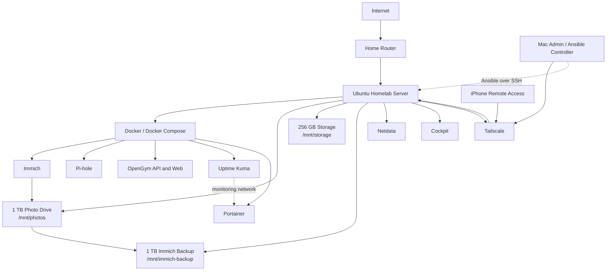
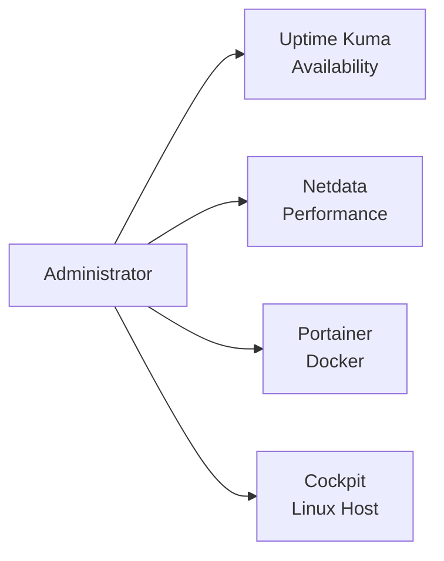
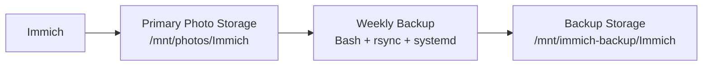
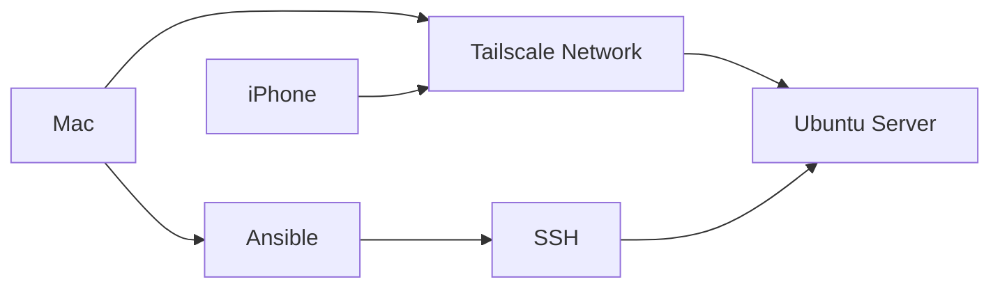
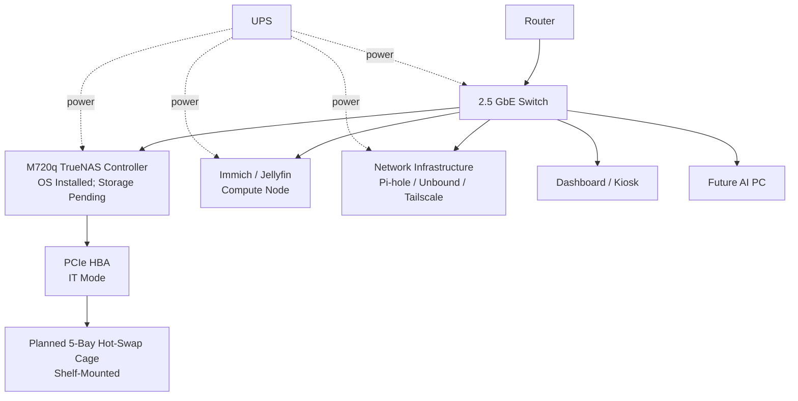

# Homelab Architecture Diagram

This page provides a simplified visual map of the current homelab and the planned future direction.

The diagrams are intentionally sanitized for public documentation. Exact public-facing addresses, credentials, tokens, and other sensitive details are not included.

## Current Homelab



Current diagram excludes Nextcloud because it was removed November 6, 2026. Its historical troubleshooting write-up is retained elsewhere in the portfolio. The final November 6 Docker check reported all nine containers healthy, including both OpenGym containers.

## Monitoring View

The monitoring stack is split by responsibility rather than relying on one dashboard for everything.



A simple way to think about the tools is:

```text
Uptime Kuma -> Can I reach the service?
Netdata     -> What is the host doing?
Portainer   -> What is happening in Docker?
Cockpit     -> What is happening on Linux?
```

## Storage and Backup Flow



The backup workflow verifies the expected storage before synchronization so an existing mount-point directory is not mistaken for a mounted disk.

## Remote Administration



An important distinction in this design is:

```text
Tailscale = secure network path
SSH       = remote shell / transport
Ansible   = automation using SSH
```

## Future Rack Direction

The planned architecture separates persistent storage, application compute, and network infrastructure.



## Separation of Responsibilities

The long-term design is based on clear infrastructure roles:

```text
NAS
= authoritative persistent storage

Immich / Jellyfin compute
= application processing

Network infrastructure
= DNS, remote-access networking, watchdogs, lightweight monitoring

Dashboard device
= display only

AI system
= separate high-power compute workload
```

This separation makes individual systems easier to troubleshoot, replace, and upgrade without coupling every workload to the same machine.

## Design Principles

The architecture is being built around several principles:

- keep persistent data separate from replaceable compute where practical
- use direct Ethernet for the rack while it remains near the router
- target 2.5 GbE for storage-to-compute traffic
- keep heavy rack equipment lower
- maintain front-to-rear airflow
- actively cool the future HBA
- use monitoring at multiple layers
- make automation persistent and reboot-safe
- sanitize public documentation
- treat redundancy and backups as separate concerns

## Status

The current-server sections describe deployed systems.

The M720q controller has TrueNAS SCALE installed and initial Ethernet/web access verified. The future rack, HBA, five-bay cage, data pool, shares, and storage migration remain **planned**, not deployed.
